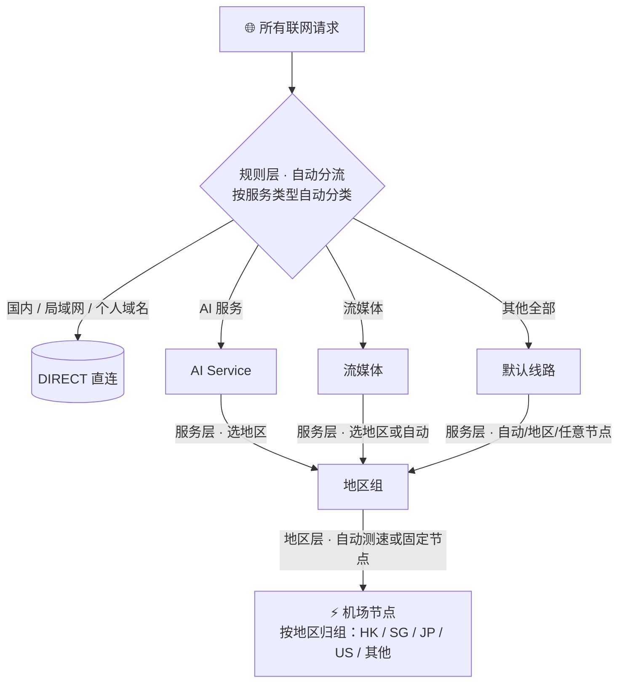
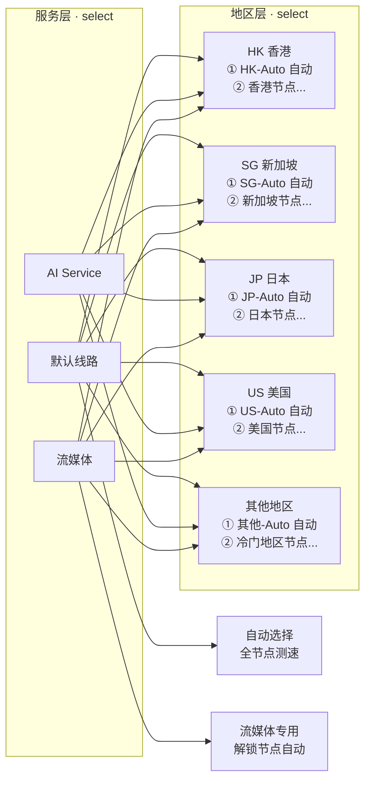
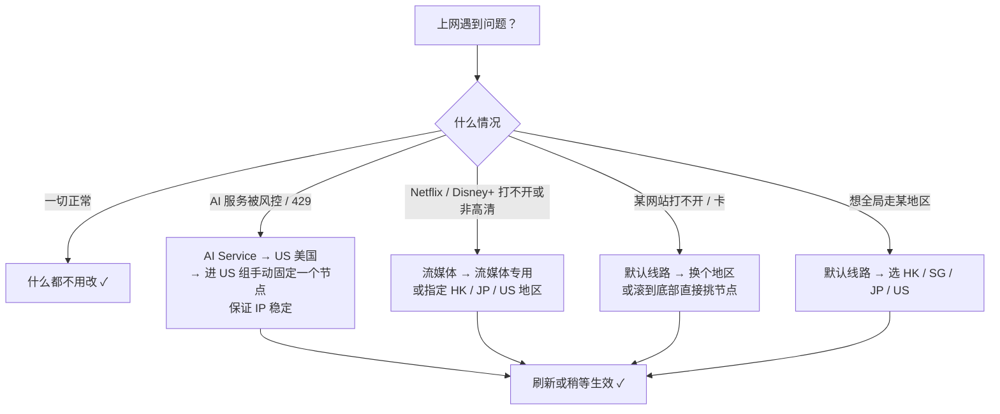

```
██████╗  ██╗ ███╗   ███╗ ██████╗   █████╗  ██╗ ██╗
██╔══██╗ ██║ ████╗ ████║ ██╔══██╗ ██╔══██╗ ██║ ██║
██║  ██║ ██║ ██╔████╔██║ ██████╔╝ ███████║ ██║ ██║
██║  ██║ ██║ ██║╚██╔╝██║ ██╔══██╗ ██╔══██║ ██║ ██║
██████╔╝ ██║ ██║ ╚═╝ ██║ ██║  ██║ ██║  ██║ ██║ ███████╗
╚═════╝  ╚═╝ ╚═╝     ╚═╝ ╚═╝  ╚═╝ ╚═╝  ╚═╝ ╚══════╝
```

# Dimrail

开源的 Clash Meta（Mihomo）代理配置项目：通过 Cloudflare Worker 做订阅中转，聚合多个机场订阅，并下发一套**按服务智能分流、按地区灵活选线**的分层策略。日常配合 [FlClash](https://github.com/chen08209/FlClash) 使用，客户端只需订阅一个地址。

## 特性

- 🎯 **分层分流策略**：规则层自动分类 → 服务层选地区 → 地区层选节点，每一层职责单一（见下方「策略设计」）
- 🔀 **多机场聚合**：任意多个机场订阅存于 Cloudflare Secret，Worker 统一中转，配置里不暴露真实订阅链接
- 📊 **用量一览**：中转透传各机场流量/到期信息，并在主订阅聚合展示（FlClash 直接可见）
- 🔐 **私有入口**：所有请求需要 `?token=` 访问密钥，密钥存于 Secret，不进仓库
- 🚀 **Clash Meta 特性**：Sniffer、Fake-IP、DNS 分流、节点自动测速（TUN/端口由 FlClash 客户端管理）
- 🧩 **第三方规则集**：Apple/GitHub/AI/流媒体等分类规则优先使用社区高质量规则集（Loyalsoldier、MetaCubeX），每日自动更新
- ⚡ **一键部署**：`npm run deploy`，或配置 GitHub Actions 后 push 即自动部署

---

## 架构（服务部署）

```
┌─ FlClash（只订阅一个地址）───────────────────────────┐
│  https://<worker>.workers.dev/?token=xxx            │
└───────────────┬──────────────────────────┬──────────┘
                │ ① 拉取主配置               │ ③ 按需拉取各机场节点
                ▼                          ▼
        ┌───────────────────────────────────────┐
        │            Cloudflare Worker           │
        │  GET /                   → Clash 主配置 │
        │  GET /providers/<name>   → 中转机场订阅  │
        └──────────────┬──────────────┬──────────┘
                       │ ② fetch      │ ④ fetch
                       ▼              ▼
              ┌──────────────┐  ┌──────────────┐
              │ 机场 A（Secret）│  │ 机场 B（Secret）│
              └──────────────┘  └──────────────┘
```

主配置由构建脚本读取 `configs/clash.yaml` 生成；`proxy-providers` 段在 Worker 请求时从 Secret 注入，其中每个 provider 的 `url` 都指向 Worker 自己的 `/providers/<name>` 中转地址——**配置中不出现任何真实机场链接**。中转时会先把机场订阅**裁剪为纯 `proxies` 节点列表**再返回，机场自带的 rules / proxy-groups / dns 等一律丢弃，并透传 `subscription-userinfo`（流量/到期）信息。

---

## 策略设计（核心）

整套分流策略由 **四个层次** 组成，每个请求从上到下流经各层，每层只做一件事：



### 分层一览

| 层 | 对应组 | 干什么 | 需要你做什么 |
|---|---|---|---|
| ① 规则层 | `rules:`（不可见） | 按服务类型把流量自动分类：AI → AI Service、流媒体 → 流媒体、国内 → 直连、其余 → 默认线路 | **什么都不用做**，全自动 |
| ② 服务层 | `默认线路` `AI Service` `流媒体` | 决定「这个服务用哪个地区的节点」 | 下拉选地区（或保持默认） |
| ③ 地区层 | `HK 香港` `SG 新加坡` `JP 日本` `US 美国` `其他地区` | 决定「这个地区用自动测速还是固定某个节点」 | 默认自动；高敏感场景进组手动固定 |
| ④ 节点层 | 机场节点（161+） | 实际出口 IP | 无需操作 |

### 三层分组的具体选项



- **默认线路**：兜底入口，最灵活——自动选择（全节点测速）、地区组、或直接手动挑任意节点
- **AI Service**：只允许选地区（防误操作），并支持「跟随默认线路」
- **流媒体**：只允许选地区，可走「流媒体专用」自动解锁组，也支持「跟随默认线路」
- **每个地区组**：第一项是 XX-Auto（自动测速选该地区最优），后面是该地区全部节点（手动固定，IP 不跳）

### 规则层分流了什么

| 规则 | 去向 | 为什么 |
|---|---|---|
| OpenAI / Claude / Gemini 等 | `AI Service` | **高风控**：固定美/英/日/坡节点，避免账号被风控 |
| Netflix / Disney+ / Prime / HBO / YouTube / Spotify | `流媒体` | **解锁**：需要地区正确且未被标记的节点 |
| Apple 中国（apple-cn） | `DIRECT` | 国内 Apple 服务直连更快 |
| 国内服务补充（direct 规则集） | `DIRECT` | 覆盖 GEOSITE,cn 之外的国内域名 |
| `GEOSITE,cn` / `GEOIP,CN` | `DIRECT` | 中国网站 / 中国 IP 兜底直连 |
| 其余一切 | `默认线路` | 兜底：保证海外流量必走代理 |

规则集（`rule-providers`）优先使用第三方维护的社区高质量规则（[Loyalsoldier/clash-rules](https://github.com/Loyalsoldier/clash-rules)、[MetaCubeX/meta-rules-dat](https://github.com/MetaCubeX/meta-rules-dat)），客户端按配置的 interval 自动更新；只有第三方没有的（AI 长尾）才自维护，详见 [`rules/README.md`](rules/README.md)。

### 日常决策速查



> 💡 **一句话记住**：日常只管「默认线路」；AI 被风控管「AI Service」；视频解锁管「流媒体」。

---

## 快速开始

前置：Node.js 18+、一个 Cloudflare 账号（免费计划即可）。

```bash
# 1. 克隆并安装
git clone https://github.com/rokcso/dimrail.git
cd dimrail
npm install

# 2. 登录 Cloudflare（浏览器授权一次）
npx wrangler login

# 3. 配置两个 Secret：机场订阅映射 + 访问密钥
npx wrangler secret put PROVIDERS_JSON   # 输入: {"机场A":"https://sub.xxx/link/...","机场B":"https://sub.yyy/link/..."}
npx wrangler secret put ACCESS_TOKEN     # 生成: openssl rand -hex 24

# 4. 部署
npm run deploy

# 5. FlClash 中添加订阅
#    https://<你的worker>.workers.dev/?token=<ACCESS_TOKEN>
```

> 说明：`PROVIDERS_JSON` 的键（机场名）只允许字母、数字、`_`、`-`；值必须是机场订阅 URL（一般带 `?client=clashmetasimple` 之类的参数）。

## 日常使用

| 想做什么 | 怎么做 |
|---|---|
| 改分流规则 / 策略组 | 编辑 `configs/clash.yaml` → `npm run deploy`（或 push） |
| 加 / 换机场 | `npx wrangler secret put PROVIDERS_JSON` 更新映射，无需重新部署 |
| 换访问密钥 | `npx wrangler secret put ACCESS_TOKEN` 后重新部署 |
| 本地调试 | `cp .dev.vars.example .dev.vars` 填入测试值 → `npm run dev` |
| 更新规则集 | 无需操作——第三方规则集由客户端按 interval 自动拉取更新 |

## GitHub Actions 自动部署

push 到 `main` 即自动部署（也可手动触发）。需要在仓库 Settings → Secrets and variables → Actions 中配置：

| Secret | 值 |
|---|---|
| `CLOUDFLARE_API_TOKEN` | Cloudflare API Token（权限：Workers Scripts 编辑） |
| `CLOUDFLARE_ACCOUNT_ID` | Cloudflare 账号 ID |
| `PROVIDERS_JSON` | 同上面的机场订阅映射 |
| `ACCESS_TOKEN` | 同上面的访问密钥 |

之后日常改规则只需 `git push`。

## 本地独立使用（不经过 Worker）

如果你不需要中转，直接把 `configs/clash.yaml` 中 `proxy-providers` 的 `url` 替换为机场订阅链接，然后在 FlClash 中导入该文件即可。

## 项目结构

```
dimrail/
├── configs/
│   └── clash.yaml              # 主配置模板（手写分流规则、代理组、DNS；端口/TUN 由 FlClash 接管）
├── rules/                      # 列表型规则集（rule-providers 远端拉取）
│   ├── ai-offshore.yaml        # 仅保留自维护：AI 长尾（头部走第三方）
│   └── README.md               # 规则集来源策略与维护说明
├── workers/
│   └── src/
│       ├── worker.js           # Worker 源码（鉴权 / 主配置 / 订阅中转 / 用量聚合）
│       └── config.generated.js # 构建产物（git 忽略，勿手改）
├── scripts/
│   └── generate.mjs            # 构建脚本：读取 clash.yaml，注入运行时标记
├── wrangler.jsonc              # Wrangler 配置
├── .github/workflows/deploy.yml
└── package.json
```

## License

MIT License
